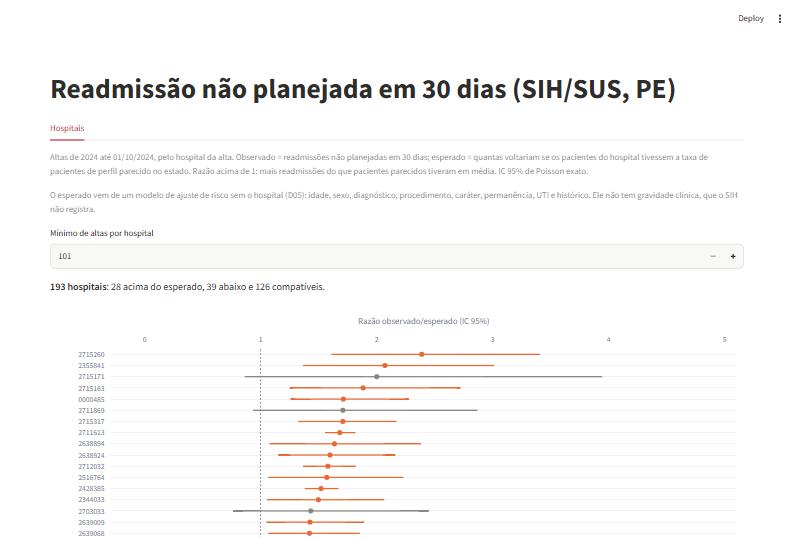

# Readmissão SUS

Previsão de readmissão hospitalar não planejada em 30 dias com dados públicos do SIH/SUS (Pernambuco, 2023–2024) e geração do Sumário de Alta em FHIR no padrão da RNDS.

## Em resumo

- **5,5% das altas voltam ao hospital sem planejamento em até 30 dias:** 51.891 de 940.139 altas do SUS em Pernambuco. A mesma pessoa é achada nas AIHs sem CPF nem CNS, por uma chave determinística.
- **O modelo ordena o risco com ROC-AUC 0,79** num ano que ele não viu: treina com as altas de 2023 e é testado em 420.746 altas de 2024. É bem calibrado (erro médio de 0,4 ponto percentual). Serve para apontar grupos de risco, não para decidir caso a caso.
- **O primeiro resultado (0,84) era bom demais, e foi investigado.** O excesso vinha de voltas programadas (quimioterapia, cirurgia em etapas) e de AIHs administrativas do mesmo hospital. Sem elas no alvo (D04 e D03), o número caiu para 0,79, o resultado honesto.
- **Hospitais comparados com ajuste de risco:** dos 193 com pelo menos 100 altas, 28 têm mais readmissões do que pacientes de perfil parecido no estado e 39 têm menos (D05).
- **Cada alta vira um Sumário de Alta em FHIR R4**, validado com o validador da HL7 e os perfis da RNDS e da SES-GO, e uma API local devolve o documento junto com o risco.



| Parte | Como foi feita |
| --- | --- |
| Dados | SIH-RD baixado do FTP do DATASUS, lido com `pyreaddbc`, guardado em Parquet e montado em DuckDB com SQL versionado |
| Linkage | chave NASC + SEXO + CEP + MUNIC_RES guardada só como hash SHA-256 com sal; colisões medidas e marcadas |
| Modelo | scikit-learn e XGBoost, validação temporal, validação cruzada agrupada por pessoa, investigação de vazamento a cada treino |
| Interoperabilidade | FHIR R4, perfis da RNDS e da SES-GO, validador oficial da HL7 em Docker |
| Serviço | API em FastAPI e dashboard em Streamlit com Plotly |
| Qualidade | 180 testes com pytest; cada decisão de método registrada em `docs/decisoes.md` |

> **Aviso:** este é um projeto de estudo e portfólio feito sobre dados públicos e anonimizados do DATASUS. Não é ferramenta clínica e não deve apoiar decisões sobre pacientes reais.
>
> **Não há envio real à RNDS.** Os documentos FHIR são gerados e validados apenas localmente, com o validador oficial da HL7 e os perfis publicados. Nenhum dado é transmitido à Rede Nacional de Dados em Saúde.

As limitações do projeto estão na seção [Limitações](#limitações), no fim deste README.

## Objetivo

1. Baixar as AIHs reduzidas (RD) do SIH/SUS de Pernambuco, de 2023 e 2024, direto do FTP do DATASUS.
2. Montar a base de internações e identificar readmissões não planejadas em até 30 dias após a alta.
3. Treinar e avaliar um modelo que estima o risco de readmissão.
4. Gerar, para cada alta, um Sumário de Alta em FHIR conforme os perfis da RNDS e validá-lo localmente.
5. Servir o Sumário de Alta com o risco numa API local e mostrar a razão observado/esperado por hospital num dashboard.

É a segunda versão do projeto Health-Project, que usava um conjunto de dados de diabetes dos EUA. Esta versão troca a fonte por dados brasileiros e acrescenta a interoperabilidade com FHIR.

## Estrutura

```
readmissao-sus/
├── api/               # API FastAPI do Sumário de Alta com risco
├── dashboard/         # dashboard Streamlit: aba Hospitais
├── data/              # dados baixados e processados (fora do git)
├── docs/              # decisões, coorte, atributos, modelo, inventário do SIH e imagens
├── fhir/pacotes/      # pacotes FHIR (.tgz) usados na validação
├── fhir/exemplos/     # Sumário de Alta de exemplo: um válido e um propositalmente inválido
├── fhir/saida/        # Sumários de Alta gerados de episódios reais (fora do git)
├── models/            # modelo treinado e metadata (fora do git)
├── reports/           # agregados do modelo e dos hospitais (só os listados no .gitignore vão para o git)
├── scripts/           # comandos da seção "Como rodar"
├── sql/               # SQL versionado do banco DuckDB (staging, internações, coorte, episódios, atributos)
├── src/readmissao_sus/  # código do pacote
├── tests/             # testes com pytest
├── pytest.ini
└── requirements.txt
```

Os arquivos de dados (`.dbc`, `.dbf`, `.parquet`, `.duckdb`) e as pastas `data/`, `models/` e `fhir/saida/` nunca vão para o git. Em `reports/` e `docs/` só ficam agregados.

Documentos de apoio:

| Arquivo | Conteúdo |
| --- | --- |
| `docs/decisoes.md` | D01 linkage, D02 perfil FHIR, D03 contíguas sem motivo (decidida: `mesmo_hospital`), D04 readmissões programadas, D05 ajuste de risco dos hospitais |
| `docs/coorte.md` | filtros, marcas, sal da chave e contagens do banco |
| `docs/atributos.md` | definição e contagens de cada atributo do modelo |
| `docs/modelo.md` | atributos que entram e ficam fora, validação cruzada e checagens |
| `docs/inventario-sih.md` | colunas do SIH-RD e fontes do dicionário |

## Como rodar

Requer Python 3.13. No Windows:

```powershell
py -3.13 -m venv .venv
.venv\Scripts\python -m pip install -r requirements.txt
.venv\Scripts\python -m pytest -q
```

Os comandos abaixo seguem a ordem do pipeline. Todos rodam na raiz do projeto.

| Passo | Comando | Argumentos |
| --- | --- | --- |
| 1. Baixar o SIH-RD | `scripts\baixar_sih.py` | nenhum |
| 2. Medir o linkage | `scripts\medir_linkage.py` | nenhum |
| 3. Construir o banco | `scripts\construir_banco.py` | `--contiguas-sem-motivo`, `--sem-permanencia`, `--eletiva-nao-programada` |
| 4. Baixar os pacotes FHIR | `scripts\baixar_pacotes_fhir.py` | nenhum |
| 5. Treinar o modelo | `scripts\treinar.py` | `--banco`, `--dir-modelo`, `--dir-relatorios`, `--random-state`, `--fracao-cv` |
| 6. Razão O/E por hospital | `scripts\razao_hospitais.py` | `--banco`, `--dir-modelo`, `--saida`, `--minimo-altas`, `--random-state` |
| 7. Gerar Sumários de Alta | `scripts\gerar_sumarios.py` | `--banco`, `--saida`, `--sem-validar`, `--sem-terminologia` |
| — Validar um documento FHIR | `scripts\validar_fhir.py <arquivo ou pasta>` | `--perfil`, `--sem-terminologia`, `--log` |

Os scripts com argumentos aceitam `--help`. Os três sem argumentos são idempotentes: rodar de novo não baixa nem converte o que já existe.

### 1. Baixar o SIH-RD

Baixa o SIH-RD de PE (2023–2024) para `data/raw/`, converte em Parquet (`data/parquet/`) e gera o inventário de colunas (`docs/inventario-sih.md`):

```powershell
.venv\Scripts\python scripts\baixar_sih.py
```

Os arquivos `.dbc` do DATASUS são lidos com `pyreaddbc`, que funciona no Windows (o PySUS não funciona bem nesse sistema).

### 2. Medir o linkage

Mede a viabilidade do linkage (chave NASC + SEXO + CEP + MUNIC_RES, guardada só como hash) e atualiza os números em `docs/decisoes.md` (D01):

```powershell
.venv\Scripts\python scripts\medir_linkage.py
```

O documento recebe só agregados; nenhuma chave ou registro por internação é gravado.

### 3. Construir o banco

Recria do zero o banco DuckDB `data/sih.duckdb` (staging tipado, internações, coorte de altas, episódios e atributos, com o SQL versionado em `sql/`) e atualiza as contagens de `docs/coorte.md` e `docs/atributos.md`:

```powershell
.venv\Scripts\python scripts\construir_banco.py
```

Leva cerca de 5 minutos.

- **Episódios.** O banco junta num episódio as internações contíguas após transferência ou permanência. A alta comum seguida de nova AIH no mesmo hospital, no mesmo dia ou no seguinte, também continua o episódio (D03, decidida em 24/11/2026). A regra muda com `--contiguas-sem-motivo nenhuma|mesmo_hospital|todas` (padrão `mesmo_hospital`).
- **Alvo.** `readmissao_nao_planejada_30d`: readmissão em 30 dias sem as voltas programadas. A volta eletiva conta como programada (D04); `--eletiva-nao-programada` deixa só a lista de procedimentos e CIDs sempre programados. O alvo antigo, `readmissao_30d`, fica como coluna auxiliar.
- **Atributos.** A tabela `atributo_episodio` (`sql/06_atributos.sql`) tem uma linha por episódio elegível: o alvo, os atributos do paciente e do episódio e o histórico da mesma chave nos 365 dias antes da entrada, sem vazamento. As definições e as fontes dos códigos (capítulo da CID-10, grupo SIGTAP) estão em `docs/atributos.md`.
- **Chave.** O banco guarda a chave de linkage como SHA-256 com sal. O sal vem de `READMISSAO_SAL_CHAVE` ou de `data/sal_chave.txt` (criado na primeira vez). Banco, sal e chave ficam em `data/`, fora do git. O motivo do sal está em `docs/coorte.md`.

### 4. Baixar os pacotes FHIR

Baixa os pacotes FHIR do Sumário de Alta para `fhir/pacotes/` (versão e SHA-256 fixos):

```powershell
.venv\Scripts\python scripts\baixar_pacotes_fhir.py
```

Não há perfil FHIR nacional do Sumário de Alta publicado. O projeto usa o perfil `sumario-alta` do guia CORE da SES-GO (versão 1.2.6, **rascunho**, ambiente de homologação) com os artefatos da RNDS do pacote `br.go.ses.reds-go`. Os motivos e as URLs canônicas estão na D02 de `docs/decisoes.md`.

### 5. Treinar o modelo

Depois de `construir_banco.py`, treina o modelo com validação temporal:

```powershell
.venv\Scripts\python scripts\treinar.py
```

Leva cerca de 10 minutos em CPU de 12 threads (`random_state = 42`). O script lê `atributo_episodio`, usa o alvo `readmissao_nao_planejada_30d`, treina com as altas de 2023 e testa nas de 2024 até o corte de censura (01/10/2024). Grava o pipeline e o limiar em `models/` (fora do git) e só agregados em `reports/metrics.json` e `reports/importancia_atributos.csv`. Nenhuma previsão por episódio é gravada. Os números estão em [Resultados do modelo](#resultados-do-modelo). Os resultados do primeiro modelo, com o alvo antigo (`readmissao_30d`, S10), ficam em `reports/metrics_s10.json` e `reports/importancia_atributos_s10.csv`, para comparação.

### 6. Razão O/E por hospital

Gera `reports/hospitais_oe.csv` e `reports/hospitais_ajuste.json` (vão para o git; só agregados):

```powershell
.venv\Scripts\python scripts\razao_hospitais.py
```

O esperado vem de um modelo de ajuste de risco sem o hospital da alta (D05): o mesmo XGBoost, treinado com as altas de 2023, aplicado às do teste (2024 até 01/10/2024) e recalibrado para que o total esperado bata com o observado no ano. O script pontua tudo em memória e agrupa pelo hospital da alta (`cnes_alta`). Leva cerca de 2 minutos. Colunas: `cnes`, `altas`, `observado` (readmissões não planejadas em 30 dias), `esperado` (soma das probabilidades), `razao_oe` e `ic95_inf`/`ic95_sup` (IC 95% de Poisson exato para o observado, dividido pelo esperado). Entram só hospitais com pelo menos 100 altas (`--minimo-altas`). O JSON traz o ROC-AUC do ajuste, o fator de recalibração e quantos hospitais ficam acima e abaixo, com o ajuste e com o modelo principal (se houver modelo em `models/`). Nenhuma probabilidade por episódio é gravada. Os números estão em [Hospitais](#hospitais-razão-observadoesperado).

### 7. Gerar Sumários de Alta

```powershell
.venv\Scripts\python scripts\gerar_sumarios.py
```

O script escolhe 20 episódios do banco e grava um Bundle FHIR por episódio em `fhir/saida/`. Essa pasta fica fora do git, porque os Bundles vêm de dados reais do SIH. Depois o script valida a pasta inteira numa só chamada do validador. `--sem-validar` só gera os arquivos. Como o Bundle é montado está em [Sumário de Alta em FHIR](#sumário-de-alta-em-fhir).

### Validar um documento FHIR (validador HL7 em Docker)

O validador oficial da HL7 (`validator_cli.jar` 7.0.3, SHA-256 conferido) roda num container `eclipse-temurin:21.0.13.1_2-jre` (tag e digest fixos). Não é preciso instalar Java no Windows; basta o Docker Desktop aberto.

```powershell
.venv\Scripts\python scripts\validar_fhir.py fhir\exemplos\sumario-alta-valido.json
.venv\Scripts\python scripts\validar_fhir.py fhir\exemplos\sumario-alta-invalido.json
```

O script valida contra `fhir/pacotes/` (`-ig`), aplica o perfil `sumario-alta` à Composition do Bundle (`-bundle Composition:0 <perfil>`), lê o OperationOutcome gerado com `-output` e imprime as mensagens e um resumo (erros, avisos, informações). Código de saída: **0** sem erros, **1** com erro de validação, **2** se o validador não rodou (Docker parado, pacote ausente etc.).

- O jar é baixado uma vez para `.cache/validador/` (fora do git). As dependências HL7 (`hl7.fhir.r4.core`, `hl7.terminology.r4`, `hl7.fhir.uv.extensions.r4` etc.) e as respostas do servidor de terminologia ficam no volume Docker `readmissao-sus-fhir`. A primeira execução baixa cerca de 200 MB e leva alguns minutos; depois, cada validação leva de 30 s a 1 min (quase tudo é a carga dos pacotes).
- Por padrão os códigos são conferidos no servidor de terminologia `tx.fhir.org`. Se ele não responder, o script valida de novo com `-tx n/a` e diz isso na linha "Modo". `--sem-terminologia` força esse modo. Sem terminologia, códigos de CodeSystems externos (LOINC, SNOMED etc.) não são checados; os CodeSystems e ValueSets que vêm completos nos pacotes (CID-10, Tabela SUS, municípios e demais tabelas da RNDS) continuam sendo checados localmente.
- Duas mensagens causadas pelo próprio perfil da SES-GO, e não pelo documento, aparecem como `[CONHECIDA]`, com a justificativa, e não contam como aviso. A lista fica em `MENSAGENS_CONHECIDAS` (`src/readmissao_sus/validador_fhir.py`) e está explicada na D02 de `docs/decisoes.md`.

Os exemplos em `fhir/exemplos/` usam só dados fictícios. O inválido tem dois erros de propósito: falta a seção obrigatória "Procedimento(s)" e o diagnóstico usa `I5099`, que não existe na CID-10.

Uma pasta também pode ser validada. Todos os `.json` dela passam numa única execução do validador (os pacotes carregam uma vez só), com uma linha de resumo por arquivo e o total:

```powershell
.venv\Scripts\python scripts\validar_fhir.py fhir\saida
```

Os testes de integração (rodam o validador de verdade; pulados se o Docker estiver ausente ou parado) ficam fora da suíte padrão:

```powershell
.venv\Scripts\python -m pytest -m integracao
```

### API e dashboard

Os dois leem só o que fica fora do git (`data/sih.duckdb`, `data/parquet/`, `models/`) ou agregados de `reports/`. Rode antes `construir_banco.py`, `treinar.py` e, para o dashboard, `razao_hospitais.py`.

**API** (FastAPI):

```powershell
.venv\Scripts\python -m uvicorn api.main:app --port 8000
```

- `GET /saude`: `{"status": "ok", "modelo": ..., "limiar": ...}`, ou `"indisponivel"` se faltar banco, Parquet ou modelo.
- `GET /episodios/{id}/sumario-alta`: o Bundle FHIR do Sumário de Alta (`bundle`) mais `probabilidade` de readmissão não planejada em 30 dias, `limiar`, `acima_do_limiar` e `modelo`. Responde 404 se o episódio não existe ou não é elegível (sem linha em `atributo_episodio`), 422 se o hospital da alta não tem CNPJ ou município nos Parquet (o Bundle não pode ser montado) e 503 sem banco ou modelo.

Documentação interativa em `http://localhost:8000/docs`. O banco é aberto só para leitura, uma vez, e cada requisição usa um cursor próprio. Os caminhos mudam com `READMISSAO_BANCO`, `READMISSAO_PARQUET` e `READMISSAO_MODELOS`. A API devolve dados de um episódio real: é para uso local, sem autenticação, e não deve ser exposta na rede.

**Dashboard** (Streamlit):

```powershell
.venv\Scripts\python -m streamlit run dashboard\app.py
```

Abre em `http://localhost:8501`. A aba **Hospitais** lê só `reports/hospitais_oe.csv`: um filtro de mínimo de altas, o gráfico da razão O/E com o IC 95% de cada hospital (laranja: IC inteiro acima de 1; azul: inteiro abaixo; cinza: compatível com o esperado) e a tabela. Nada por episódio aparece no dashboard.

## Sumário de Alta em FHIR

`src/readmissao_sus/fhir_sumario.py` transforma um episódio num Bundle do tipo `document`. O Bundle tem Composition (`sumario-alta`), Patient, Encounter, Organization, Practitioner, um Condition por CID-10 e um Procedure por AIH, com os perfis da D02. A construção (`montar_bundle`) é uma função pura, testada sem banco. A leitura dos episódios fica em `src/readmissao_sus/episodio_leitura.py`, e os mapeamentos de código ficam em `src/readmissao_sus/sih_fhir_mapa.py`.

A amostra de `gerar_sumarios.py` é estratificada e determinística (ordem por `md5(episodio_id)` em cada estrato). Os estratos são: episódio simples eletivo e de urgência dos dois sexos, acidente (`CAR_INT` 05/06), menor de 1 ano, longa permanência (AIH 5), saída final por transferência, transferência entre hospitais (urgência e eletivo), permanência (urgência e eletivo) e transferência com permanência. Entram só episódios cujos códigos existem nos CodeSystems do pacote da RNDS e cujo hospital da alta tem CNPJ e município nos Parquet. Em toda a base, só 4 internações têm CID fora do BRCID10 e 902 têm procedimento fora do BRTabelaSUS.

Resultado em 23/11/2026, com terminologia (tx.fhir.org): **20 de 20 Bundles válidos, 0 erro**. Cada arquivo tem 2 avisos e 2 ou 3 mensagens conhecidas do perfil (as da D02). Os 2 avisos são a invariante `NumeroTelefoneValido` no telefone do hospital e no do profissional: o SIH não tem telefone, e o valor vai como ausente (ver abaixo). São avisos do documento, não do perfil, e por isso não entram em `MENSAGENS_CONHECIDAS`.

### Mapeamento campo do SIH -> elemento FHIR

| Campo do SIH-RD | Origem | Elemento FHIR | Regra |
| --- | --- | --- | --- |
| `N_AIH` da primeira AIH (`episodio_id`) | banco | `Bundle.identifier`, `fullUrl` de cada entrada | UUID v5 determinístico por episódio e papel; os `N_AIH` aparecem na narrativa do Encounter |
| `DT_INTER` da primeira AIH | banco | `Encounter.period.start` | data (o SIH não tem hora) |
| `DT_SAIDA` da última AIH | banco | `Encounter.period.end`, `Condition.recordedDate` | data |
| `CAR_INT` da primeira AIH | banco | `Encounter.priority` (BRCaraterAtendimento) | 01 → 01 Eletivo; 02 → 02 Urgência; 03–06 (acidentes e lesões) → 02; outro → 99 |
| `COBRANCA` da última AIH | banco | `Encounter.hospitalization.dischargeDisposition` (BRMotivoDesfecho) | 11, 12, 13, 17, 19, 61–64 → 01 Alta clínica; 14 → 02 Alta voluntária; 16 → 04 Evasão; 15 → 08 Retorno; 21–28 → 07 Permanência; 29, 31, 32 → 09 Transferência; 41–43, 65–67 → 06 Óbito; 18 e 51 → 99 Sem registro |
| — | fixo | `Encounter.class` (BRModalidadeAssistencial) | 04 Atenção Hospitalar |
| — | ausente no SIH | `Encounter.hospitalization.admitSource` (BRProcedencia) | 99 Informação ausente no modelo de origem |
| `DIAG_PRINC` de cada AIH | banco | `Condition.code` (BRCID10), `Encounter.diagnosis` | um Condition por CID distinto. O da primeira AIH é o principal (BRCategoriaDiagnostico 01); os outros são secundários (02). O SIH grava sem ponto (`I500`), no mesmo formato do BRCID10; um ponto, se vier, é retirado |
| `PROC_REA` de cada AIH | banco | `Procedure.code` (BRTabelaSUS, ValueSet `br-tabela-sus`), `Encounter.diagnosis` | um Procedure por AIH, 10 dígitos. `performedDateTime` é a entrada da AIH (o perfil não aceita `performedPeriod`) |
| `CNES` da última AIH | banco | `Organization.identifier` (sid/cnes), `Encounter.serviceProvider`, `Composition.author` | 7 dígitos; hospital da alta |
| `CGC_HOSP` (senão `CNPJ_MANT`) da última AIH | Parquet | `Organization.identifier` (sid/cnpj) | o perfil exige CNPJ ou CPF; sem `CGC_HOSP`, vai o CNPJ da mantenedora |
| `MUNIC_MOV` da última AIH | Parquet | `Organization.address.city` e `.state` | código IBGE de 6 dígitos (BRMunicipio); a UF são os 2 primeiros dígitos |
| `SEXO` | banco | `Patient.gender` | 1 → male; 3 → female; outro → unknown |
| `IDADE`, `COD_IDADE` | banco | `Patient.birthDate` | **aproximada**: data de entrada menos a idade (COD_IDADE 2 dias, 3 meses de 30 dias, 4 anos, 5 anos + 100). Preserva só a idade na entrada |
| `MUNIC_RES` | banco | `Patient.address.city` e cidade de nascimento (`patient-birthPlace`) | código IBGE de 6 dígitos. Na cidade de nascimento é um **substituto**: ver abaixo |
| `RACA_COR` | Parquet | extensão BRRacaCorEtnia (BRRacaCor) | mesmo código (01–05, 99) |
| `NACIONAL` | Parquet | extensão BRNacionalidade | 010 → B (brasileiro); outro → E |
| chave de linkage (hash com sal) | banco | `Patient.identifier` (sid/cns), `Patient.name` | **sintéticos**: ver abaixo |

**Dado ausente.** Quando o perfil pede um elemento que o SIH não tem, o elemento leva a extensão `data-absent-reason` (`unknown`) em vez de um valor inventado. Isso vale para o CPF do paciente, as linhas do endereço do paciente, o telefone, o CEP, o bairro e o logradouro do hospital, e o CPF e o telefone do profissional. A filiação vai com tipo `03` (Informação desconhecida) e nome "Não informado", porque a invariante do perfil exige um nome com duas palavras. Três elementos não aceitam `data-absent-reason` e recebem um substituto, dito na narrativa:

- cidade de nascimento do paciente brasileiro: a invariante `MunicipioNascimentoSeNacionalidadeBrasileira` exige um código do BRMunicipio. Vai o município de residência;
- data de nascimento do paciente: aproximada pela idade (tabela acima);
- data de nascimento do profissional: a invariante `DataComPrecisaoDeDia` exige uma data com dia. Vai `1900-01-01`, num profissional que já é um marcador.

**Paciente sintético.** O SIH-RD público não tem CNS, CPF nem nome, e o perfil `individuo` exige CPF e CNS (fatiamento fechado, 2..2). O CNS é um número sintético de 15 dígitos derivado da chave de linkage (SHA-256 com sal). A mesma pessoa tem o mesmo CNS em todos os episódios. O número começa com 0, que nenhum CNS real usa (os definitivos começam com 1 ou 2; os provisórios, com 7, 8 ou 9), então nunca é o cartão de alguém. O nome é "Paciente Sintético" seguido de 8 caracteres de outro hash da chave. NASC e CEP não são lidos: o banco não os guarda em claro, e a leitura dos Parquet seleciona só `CGC_HOSP`, `CNPJ_MANT`, `MUNIC_MOV`, `RACA_COR` e `NACIONAL`.

**Profissional.** O perfil exige um profissional como autor e como participante do Encounter, mas o SIH-RD não identifica o médico. Todos os Bundles usam o mesmo Practitioner "Profissional Não Identificado", com sexo `unknown`.

**Episódios com várias AIHs** (transferência, permanência) viram um único Encounter. O período vai da entrada da primeira AIH à saída da última. O caráter vem da primeira AIH, e o desfecho, da última. O hospital da alta é o `serviceProvider` e o autor. Os outros hospitais aparecem só na narrativa e na extensão obrigatória de evolução do Encounter, com o CNES e as datas de cada AIH. Essa extensão também diz que o SIH não traz a evolução clínica. Cada AIH tem seu Procedure.

## Resultados do modelo

Treino de 24/11/2026 com `.venv\Scripts\python scripts\treinar.py` (padrões: `--fracao-cv 0.5`, `--random-state 42`), 10 minutos em CPU de 12 threads. O alvo é `readmissao_nao_planejada_30d`: a volta eletiva ou com procedimento ou CID sempre programado não conta (D04). Os episódios seguem a D03 (`mesmo_hospital`): a nova AIH no mesmo hospital, no dia da alta ou no seguinte, continua o episódio.

Ao lado ficam dois modelos anteriores, com o mesmo protocolo:

- **antes da D03:** mesmo alvo, mas a nova AIH em 0–1 dia no mesmo hospital contava como readmissão (`reports/metrics_s13.json`);
- **S10:** o primeiro modelo, com o alvo antigo, `readmissao_30d`, que contava as voltas programadas (`reports/metrics_s10.json`).

Os números completos estão em `reports/metrics.json`; as escolhas, em `docs/modelo.md`.

Divisão temporal: **treino** com as 519.393 altas de 2023 (435.322 chaves) e **teste** com as 420.746 altas de 2024 até 01/10/2024 (356.133 chaves). 38.998 chaves têm altas nos dois anos, como teriam em uso. A validação cruzada usa 50% das chaves do treino (260.092 episódios), em 5 folds agrupados pela chave.

Validação cruzada no treino (5 folds, média ± desvio):

| Modelo | ROC-AUC | PR-AUC | ROC-AUC antes da D03 | ROC-AUC S10 |
| --- | --- | --- | --- | --- |
| Logistic Regression | 0,778 ± 0,007 | 0,251 ± 0,018 | 0,793 ± 0,002 | 0,800 ± 0,002 |
| Random Forest | 0,787 ± 0,007 | 0,283 ± 0,016 | 0,801 ± 0,002 | 0,814 ± 0,003 |
| **XGBoost (vencedor nos três)** | **0,803 ± 0,006** | **0,311 ± 0,019** | **0,824 ± 0,001** | **0,837 ± 0,002** |

Teste (XGBoost, avaliado uma vez):

| Métrica | Atual | Antes da D03 | S10 (`readmissao_30d`) |
| --- | --- | --- | --- |
| Altas no teste | 420.746 | 430.684 | 430.684 |
| Prevalência no teste | 0,054 | 0,069 | 0,120 |
| ROC-AUC | **0,791** | 0,811 | 0,839 |
| PR-AUC | 0,223 | 0,335 | 0,555 |
| Brier | 0,046 | 0,055 | 0,075 |
| Limiar (máx. F1 out-of-fold) | 0,168 | 0,208 | 0,260 |
| Precisão / recall / F1 no limiar | 0,256 / 0,294 / 0,274 | 0,350 / 0,359 / 0,354 | 0,515 / 0,513 / 0,514 |
| Matriz de confusão `[[VN, FP], [FN, VP]]` | `[[378875, 19295], [15935, 6641]]` | `[[380840, 19947], [19160, 10737]]` | `[[354367, 24825], [25098, 26394]]` |
| Calibração: maior diferença entre previsto e observado | 2,3 pontos (faixa mais alta: previsto 23,6%, observado 21,3%); média ponderada 0,4 ponto | 2,5 pontos | 0,7 ponto |

Por grupo, no mesmo limiar (entre parênteses, o ROC-AUC antes da D03 e o da S10):

| Grupo | Episódios | Prevalência | ROC-AUC | PR-AUC | Precisão | Recall |
| --- | ---: | ---: | ---: | ---: | ---: | ---: |
| **caráter eletivo (01) da internação-índice** | 137.798 | 0,020 | **0,788** (0,786; 0,902) | 0,086 | 0,143 | 0,179 |
| **caráter urgência (02) da internação-índice** | 281.294 | 0,070 | **0,761** (0,783; 0,791) | 0,250 | 0,273 | 0,311 |
| `cep_generico` = não | 230.848 | 0,052 | 0,802 (0,822; 0,857) | 0,236 | 0,267 | 0,313 |
| `cep_generico` = sim | 189.898 | 0,056 | 0,779 (0,797; 0,807) | 0,206 | 0,243 | 0,273 |
| `historico_completo` = sim | 415.036 | 0,053 | 0,792 (0,811; 0,839) | 0,222 | 0,256 | 0,293 |
| `historico_completo` = não (entrada em 2023) | 5.710 | 0,085 | 0,760 (0,799; 0,807) | 0,277 | 0,278 | 0,344 |
| `chave_colidente` = não | 413.289 | 0,053 | 0,792 (0,811; 0,840) | 0,219 | 0,255 | 0,293 |
| `chave_colidente` = sim | 7.457 | 0,108 | 0,756 (0,788; 0,796) | 0,329 | 0,296 | 0,333 |

- **A D03 tirou do alvo a maior parte das voltas em 0–1 dia.** Antes, elas eram 28,6% dos positivos do teste; agora são 6,7% (1.521). Eram AIHs do mesmo hospital, fáceis de prever pelo hospital e pelo histórico. Sem elas, o ROC-AUC caiu de 0,811 para 0,791, e a prevalência, de 6,9% para 5,4%.
- **Eletivo e urgência.** A S13 já tinha tirado o ganho das eletivas, que vinha das voltas programadas (0,902 na S10). Com a D03, a urgência cai mais (0,783 para 0,761) que a eletiva (0,786 para 0,788): as contíguas do mesmo hospital eram, em boa parte, voltas de urgência.
- **A PR-AUC caiu mais que o ROC-AUC** (0,335 para 0,223) porque a prevalência caiu. Contra a prevalência, a PR-AUC é 4,1 vezes o acaso (4,8 antes da D03; 4,6 na S10).
- **CEP genérico.** O modelo continua pior no CEP genérico (0,779 contra 0,802), porque o histórico da chave mistura pessoas. A prevalência agora é um pouco maior nesse grupo (5,6% contra 5,2%).
- **Histórico incompleto em 2023.** A variante treinada só com entradas a partir de 01/07/2023 (260.559 episódios) dá 0,788 no teste, contra 0,791 do modelo principal: o histórico curto do treino não atrapalha.
- **Calibração.** O modelo superestima um pouco o risco no decil mais alto. A taxa caiu de 5,6% no treino para 5,4% no teste. Nenhum calibrador foi aplicado.

Importância por permutação (queda de ROC-AUC no teste, 50 mil episódios): `cnes_alta` 0,048, `car_int` 0,034, `dias_permanencia` 0,030, `capitulo_cid` 0,030, `grupo_sigtap` 0,029, `idade` 0,019, `dias_desde_ultima_alta` 0,017; os demais ficam abaixo de 0,01 (`reports/importancia_atributos.csv`). Antes da D03, o hospital pesava mais (0,065). Na S10, a ordem era `grupo_sigtap` 0,062, `cnes_alta` 0,045 e `capitulo_cid` 0,026. A internação-índice eletiva volta sem programação bem menos que a de urgência (2,0% contra 7,0%), e isso se sabe na alta.

### Investigação de vazamento

Um ROC-AUC acima de 0,80 é tratado como suspeita de vazamento. O modelo atual ficou em 0,791, abaixo do limite. A investigação roda a cada treino (`investigacao_vazamento` em `reports/metrics.json`):

- **Nenhum atributo sozinho explica o resultado.** O melhor atributo isolado é `dias_desde_ultima_alta`, com ROC-AUC 0,618.
- **Nenhum grupo de atributos carrega o resultado sozinho.** Sem o histórico da chave, o teste vai a 0,777; sem o hospital da alta, a 0,773.
- **Os atributos só usam o passado.** O histórico só conta episódios terminados até a entrada, `chave_colidente` e `episodio_sobreposto` ficam fora, o teste é de um ano posterior e nenhuma chave aparece em dois folds.
- **Readmissões em 0–1 dia.** Sobram 1.521 (6,7% dos positivos). Sem elas, o teste fica em 0,793.

Os modelos anteriores passaram de 0,80 (0,839 na S10 e 0,811 antes da D03) e foram investigados. O excesso vinha das voltas programadas e das AIHs contíguas do mesmo hospital, não de dado posterior à alta. A D04 e a D03 tiraram esses casos do alvo. O número não deve ser comparado com os 0,64–0,68 do Health-Project: lá, o alvo, a base e o linkage são outros.

## Hospitais: razão observado/esperado

`reports/hospitais_oe.csv` e `reports/hospitais_ajuste.json`, gerados em 24/11/2026. O esperado vem do ajuste de risco sem o hospital (D05): quantas altas voltariam se os pacientes de cada hospital tivessem a taxa de pacientes de perfil parecido no estado. Das 420.746 altas do teste, 417.886 são de 193 hospitais com pelo menos 100 altas, com 22.344 readmissões não planejadas observadas e 22.356 esperadas: a recalibração no total do ano deixa a razão geral em 1,00.

O ajuste tem ROC-AUC 0,774 no teste, contra 0,791 do modelo principal: o hospital explica parte do risco. O fator de recalibração foi 0,946, porque a taxa caiu de 2023 para 2024.

| Leitura pelo IC 95% | Com o ajuste de risco (atual) | Com o modelo principal (antes) |
| --- | ---: | ---: |
| Acima do esperado (IC inteiro acima de 1) | 28 | 13 |
| Compatível com o esperado | 126 | 153 |
| Abaixo do esperado (IC inteiro abaixo de 1) | 39 | 27 |

Com o modelo principal, que tem o hospital como atributo, o esperado já carregava parte do efeito de cada hospital, e a razão media sobretudo a mudança do hospital em relação a 2023. Exemplo: o CNES 0000582 tinha razão 2,66 antes; com o ajuste, fica em 1,33 (IC de 1,21 a 1,47), ainda acima, mas pela metade. O maior hospital, 0000434 (28.651 altas), passa de 0,80 (abaixo) para 1,06 (IC de 1,02 a 1,10, acima).

Cuidados na leitura:

- **O ajuste só vê o que o SIH registra** (idade, sexo, diagnóstico, procedimento, caráter, permanência, UTI e histórico). Não vê gravidade clínica, exames nem condição social. Ver [Limitações](#o-ajuste-de-risco-dos-hospitais-é-limitado).
- **O esperado é tratado como fixo** no IC; a incerteza do modelo não entra.
- **São 193 comparações sem correção**: alguns hospitais ficam fora de 1 por acaso.

## Limitações

### Projeto de estudo, sem envio à RNDS

- É um projeto de estudo e portfólio. O modelo não foi validado em uso clínico, não tem calibração externa e não deve apoiar decisões sobre pacientes.
- Nada é enviado à RNDS. A validação é só local, com o validador da HL7. O perfil usado é o `sumario-alta` da SES-GO, em **rascunho** e em homologação, porque não há perfil nacional publicado (D02).
- O Sumário de Alta tem paciente e profissional sintéticos e vários elementos como ausentes: o SIH-RD público não traz CNS, CPF, nome, telefone nem evolução clínica. Ele mostra o mapeamento, não um documento clínico real.

### Linkage determinístico sem CNS

O SIH-RD público não tem CNS nem CPF. A mesma pessoa é achada pela chave NASC + SEXO + CEP + MUNIC_RES (D01). Isso traz dois erros:

- **Pessoas diferentes com a mesma chave.** Na D01, 7.214 chaves (3,50% das chaves com 2+ internações) tinham internações sobrepostas no tempo, o que é impossível para uma pessoa só. Essa conta só pega quem estava internado ao mesmo tempo; fusões em datas distantes não aparecem e também viram falsas readmissões. No teste, as altas de chave colidente têm prevalência de 0,108, contra 0,053 nas demais.
- **CEP genérico.** O CEP terminado em `000` é o CEP geral da localidade, comum no interior de PE. Cobre 45,46% das altas elegíveis (`docs/atributos.md`) e 189.898 das 420.746 altas do teste. Na D01, as colisões subiam para 4,39% nesse grupo (contra 2,77% no CEP específico). O modelo vai pior nele: ROC-AUC 0,779, contra 0,802. O histórico da chave mistura pessoas, e parte das readmissões reais some.
- Uma mudança de endereço muda a chave: a mesma pessoa vira duas.

### Contíguas sem motivo (D03)

A alta comum seguida de nova AIH no mesmo hospital, no dia da alta ou no seguinte, agora continua o episódio (D03, `mesmo_hospital`, decidida em 24/11/2026). Na maioria, é a mesma estadia em outra AIH, por motivo administrativo. Dois erros possíveis continuam:

- **No mesmo hospital,** uma volta real em menos de um dia, depois de ir para casa, agora some do alvo.
- **Em outro hospital,** a nova AIH continua contando como readmissão, mesmo quando é uma transferência sem o código. Sobram 1.521 voltas em 0–1 dia entre os positivos do teste (6,7%).

### Taxa abaixo da literatura

A taxa de readmissão não planejada é 5,52% (51.891 de 940.139 altas-índice). Fica abaixo da faixa de 11–14% das referências brasileiras citadas na D01. Os motivos prováveis (D03 e D04):

- **População.** A referência mais próxima (Porto Alegre, 13,7% de readmissões não eletivas) mede a Medicina Interna de um hospital terciário. Aqui entram todas as altas do estado, inclusive obstetrícia e cirurgia eletiva, que voltam pouco.
- **Caráter eletivo.** Toda volta eletiva conta como programada. É um critério mais largo que olhar só o procedimento e o diagnóstico: 37.750 altas saíram do alvo, e uma volta eletiva por complicação também sai. Sem esse critério (`--eletiva-nao-programada`), a taxa seria 8,08%.
- **Contíguas no mesmo hospital.** A D03 junta ao episódio a nova AIH em 0–1 dia no mesmo hospital. Antes dela, a taxa não planejada era 7,25%.
- **Linkage.** No CEP genérico, parte das readmissões reais some (ver acima).

A comparação é só indicativa: as referências não dizem como trataram AIHs administrativas nem como acharam a mesma pessoa.

### Recorte dos dados

- **Só PE, 2023–2024.** Readmissões em hospitais de outro estado não aparecem, e a alta fica como não readmitida. O SIH só registra internações pagas pelo SUS: a volta por um hospital privado também não aparece.
- **Histórico incompleto em 2023.** O histórico de 365 dias não vê nada antes de 01/01/2023. Todo o treino tem histórico incompleto. A variante treinada só com entradas a partir de 01/07/2023 dá quase o mesmo ROC-AUC (0,788 contra 0,791), mas o efeito não some por completo.
- **Censura.** Entram só altas até 01/10/2024, para que os 30 dias seguintes estejam completos no SIH.
- **Mudança de taxa.** A taxa caiu de 5,6% no treino para 5,4% no teste. O modelo superestima um pouco o risco, sobretudo no decil mais alto, e não foi recalibrado.

### O ajuste de risco dos hospitais é limitado

O esperado de cada hospital vem de um modelo sem o hospital (D05), então a razão O/E compara o hospital com pacientes de perfil parecido no estado. O perfil, porém, é só o que o SIH-RD registra. Um hospital de referência recebe os casos mais graves de cada diagnóstico, e essa gravidade não aparece nos dados: ele pode ficar "acima" por isso, e não por cuidar pior. A volta também é atribuída ao hospital da alta, mesmo quando acontece em outro. A tabela serve para apontar onde olhar, não para montar um ranking de qualidade.

### ROC-AUC dos modelos anteriores

Os modelos anteriores passaram do limite de suspeita de 0,80 (0,839 na S10 e 0,811 antes da D03). O excesso vinha das voltas programadas e das AIHs contíguas do mesmo hospital, não de dado posterior à alta (ver [Investigação de vazamento](#investigação-de-vazamento)). Com a D04 e a D03, o modelo atual fica em 0,791.
